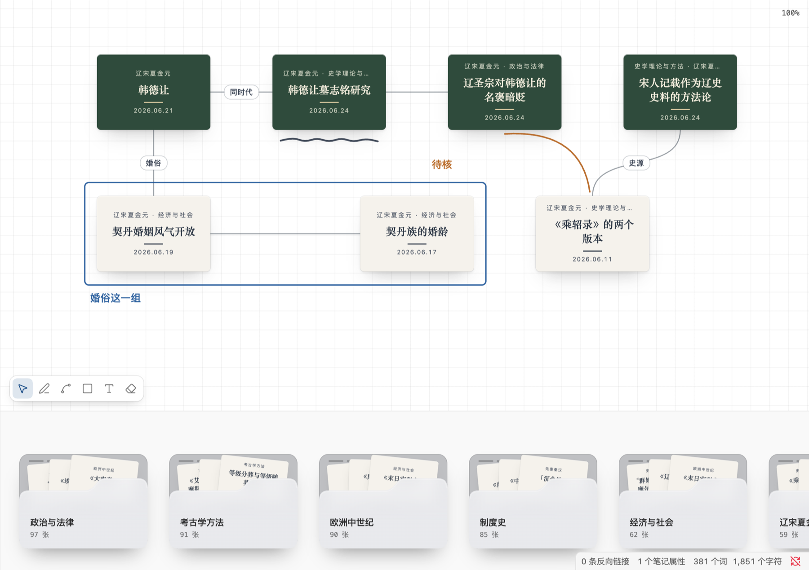

# Haoo Cardbox（卡片盒）

把写好的笔记变成一张张卡片，按领域装进文件夹；摊开卡堆挑卡，放上画板亲手摆位、连线、圈画，排成一篇 MOC 的骨架。

一块画板就是一篇 Markdown 笔记：上面是你自己写的手写区，中间是插件根据画板自动生成的 MOC 正文（一串 `[[卡片]]` 链接），末尾是藏起来的画板数据。所以反向链接、关系图谱、搜索、同步都能直接用，画板不是一座孤岛。

> 桌面端专用（`isDesktopOnly`）。当前是 v1：卡堆栏、画板、连线、标注、卡片上色、导出 `.canvas` 都已可用。



## 前置条件

- Obsidian 1.5 或更高，桌面端（macOS / Windows / Linux）。
- 笔记带 `domain/*` 标签，一个领域对应一个卡堆；前缀可以在设置里改。
- 想在卡片上区分类型，就在 frontmatter 里写 `type`：`literature`（文献）、`permanent`（永久）、`fleeting`（闪念，`flash` 和「闪念」也认）；不写算未分类。

## 安装

从源码构建一次：

```bash
npm install
npm run build      # 产物在 dist/
```

把 `dist/` 里的 `main.js`、`manifest.json`、`styles.css` 拷进库的 `.obsidian/plugins/skeuomorphic-cards/`（文件夹名要和 manifest 的 `id` 一致），然后在「设置 → 第三方插件」里启用。

开发时更省事的做法：把 `.obsidian/plugins/skeuomorphic-cards/` 直接做成指向本仓库 `dist/` 的符号链接，跑 `npm run dev` 监听构建，改完在 Obsidian 里重载插件。

## 用起来

### 画板

- 「新建画板」在命令面板里，或点左侧 ribbon 图标；新建的画板放在当前笔记所在的文件夹。
- 拖空白处平移，普通滚轮上下平移，`⌘` + 滚轮或双指捏合缩放。
- 拖卡片摆位，选中的几张一起动；`⌘` 单击在右侧分栏打开原笔记，`⌘` 悬停看 Obsidian 原生的页面预览。
- 双击翻面，看来源、作者、日期和正文开头；再双击翻回。
- 右键卡片：在右侧打开、翻面、卡片颜色、从画板上拿下。
- `⌘Z` / `⇧⌘Z` 撤销和重做卡片、连线、标注（平移缩放不算）。

### 卡堆栏

- 画板下方一排文件夹，一个领域一个，按卡片数从多到少排；多了横向滚动，竖着滚轮也能左右翻。
- 悬停文件夹，露出的卡往上抽出一截；点开后卡片散开在画板上方，画板压暗。
- 在散开的卡里点选，或按住 `⇧` / `⌘` 多选，拖到画板上；多张落下时每行 4 张排成一小块。
- 已经在当前画板上的卡会压暗、拖不动。按 `Esc`、再点文件夹或点画板空白处收回。
- 右键文件夹换颜色（七种），设置里可以统一默认色或一键全部改回默认。

### 连线

- 悬停卡片，四边出现接点，从接点拖到另一张卡上就连一条曲线；按住 `⌥` 从卡面直接拖也行。
- 双击连线写短标签（最多 12 个字），清空就去掉。
- 单击选中一条线按 `Delete` 删除；一对卡片只有一条线，不分方向。

### 标注

- 工具条在画板左下角：`V` 选择、`P` 画笔、`L` 直线、`R` 矩形、`T` 文字、`E` 橡皮擦，`Esc` 回到选择。
- 三种颜色（墨、赭、靛），跟着主题变深浅；直线画完可以拖中间的点弯成曲线，按住 `⇧` 吸附到 15° 一档。
- 矩形只描边；文字直接写在画板上，双击可以改。
- 选中标注后能挪位置、改颜色、`Delete` 删除；橡皮擦碰到哪条就擦掉整条。
- 标注在卡片之上但不贴在卡片上：缩放后仍圈在原来的位置，挪走卡片时标注留在原处。

### 卡片颜色

- 默认纸色只区分笔记类型：文献是纸白、闪念淡黄、永久深绿、未分类淡灰。
- 右键「卡片颜色…」可以在卡片下方打开取色条，给选中的卡换成七种卡纸之一，或者「跟类型」还原。
- 颜色存成 `#rrggbb`，跟着画板笔记保存；导出 `.canvas` 时会一起带上。字色按底色深浅自动选深字或浅字。

### 画板笔记

- frontmatter 里有 `skeuo-board: 1` 的笔记，打开时默认进画板；视图菜单里可以「用 Markdown 打开」。
- 手写区在 MOC 正文上方，插件永远不覆盖；数据块读不出来时画板不打开，笔记原样保留。
- 改名一篇笔记或文件夹，所有画板里的路径跟着改；删除笔记后卡片变成虚线框的缺失卡片，位置和连线都留着，可以重新指向另一篇笔记。

## 设置

- **领域标签的前缀**：默认 `domain/`，可以换成自己已有的标签体系。
- **文件夹的默认颜色**：跟着主题（浅色雾白、深色石墨），也可以指定一种；单独换过色的文件夹可以一键全部改回默认。

## 数据格式

画板数据放在笔记末尾 `%%` 注释里的一个 `skeuo-board` 代码块，字段沿用 JSON Canvas：`nodes`（`file`、`x`、`y`、`width`、`height`，可选 `flipped`、`missing`、`color`）、`edges`（`fromNode`、`toNode`、可选 `label`），标注放在额外的 `strokes` 字段，另外还有 `viewport`。读不懂的顶层字段会原样保留。

「导出为 .canvas」会生成原生画板文件，卡片、坐标、连线、标签和卡片颜色照原样带过去；标注和缺失卡片原生画板不支持，导出时会提示。

## 开发

```bash
npm run dev     # 监听构建
npm run check   # tsc --noEmit
npm test        # node:test，先 esbuild 打包再跑
npm run build   # 生产构建到 dist/
```

- `src/core/` 是纯逻辑（归堆、画板笔记读写、MOC 正文、改名删除跟随、拖放排布、撤销、导出），不 import Obsidian，是唯一的测试接缝。
- `src/ui/` 是画板和卡堆栏（原生 DOM 和 SVG），`src/obsidian/` 是适配层（视图、设置、监听库变化）。
- 术语以 [GLOSSARY.md](GLOSSARY.md) 为准；「画板存成 Markdown 笔记」这个决定见 [docs/adr/0001-board-as-markdown-note.md](docs/adr/0001-board-as-markdown-note.md)。

## 已知限制

- 只支持桌面端，不做 iPad / 手机。
- 标注不进 `.canvas` 导出。
- 画板的撤销历史只在内存里，关掉画板就清空。

## 许可

[MIT](LICENSE)。
